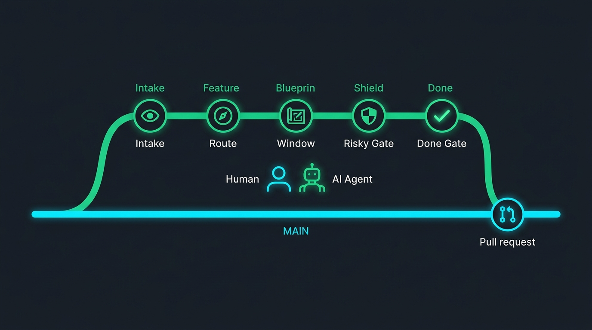
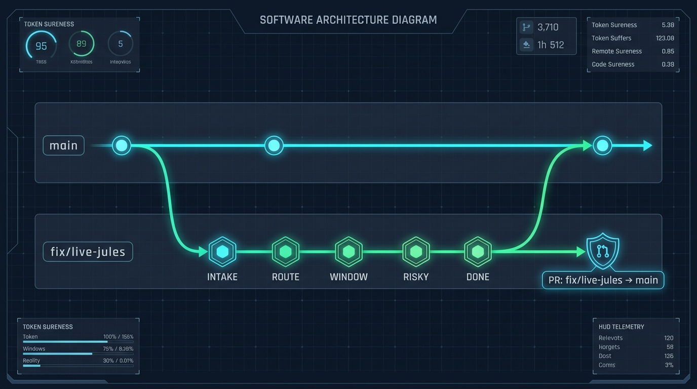
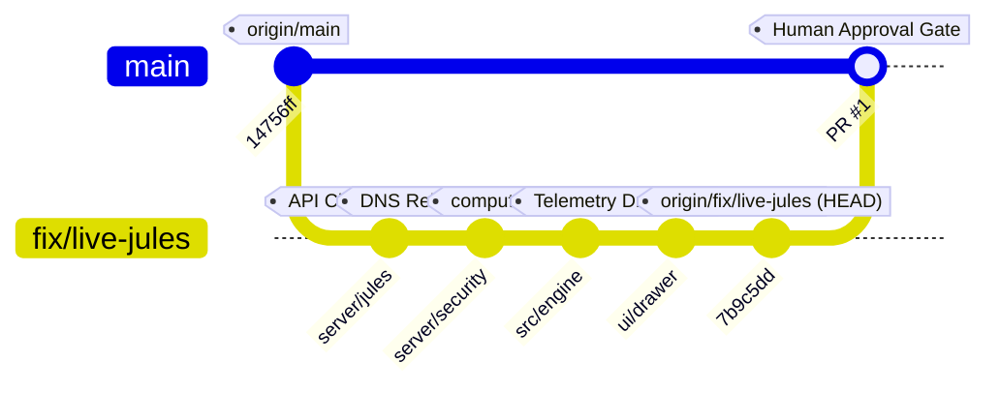

# Git Architecture & Jev Enforceable Decision Gates

This document visualizes the branch lifecycle, commit points, and Jev automated decision gates governing the live Google Jules agent integration in [jules-jev-harness](file:///Users/joewales/jules-jev-harness).

---

## 1. Visual Architecture Diagram (Clean Presentation View)

*(Detailed telemetry HUD infographic view: )*

---

## 2. Git Graph & Commit Topology

---

## 3. End-to-End Decision Gate & Branch Lifecycle

```mermaid
flowchart TD
    subgraph S1["1. Intake & Routing"]
        A["Task Created on Board"] --> B{"Jev Intake Gate"}
        B -->|act| C{"Jev Route Gate"}
        B -->|confirm| B1["Human Clarification"]
        C -->|Valid Repo & Branch| D["Branch: fix/live-jules"]
        C -->|No Repo| C1["Block Dispatch"]
    end

    subgraph S2["2. Live Agent Session"]
        D --> E["POST /api/jules/dispatch"]
        E --> F["Google Jules Coding Agent"]
        F --> G["Jules Generates Plan"]
    end

    subgraph S3["3. Plan Review Gate"]
        G --> H{"Jev Window Gate"}
        H -->|confirm| I["Human Approves Plan"]
        I -->|POST /api/jules/:id/approve| J["Jules Implements Code"]
    end

    subgraph S4["4. Implementation & Validation"]
        J --> K["Jules Runs Tests"]
        K --> L{"Session View Whitelist<br/>(npm test, vitest, pytest)"}
        L -->|Pass| M["Jules Opens PR"]
        L -->|Fail / Invalid Tool| J
    end

    subgraph S5["5. Blast Radius & Done Gate"]
        M --> N{"Jev Risky Gate"}
        N -->|In Plan & Approved| O{"Jev Done Gate"}
        N -->|Unplanned Scope| N1["Hold for Review"]
        O -->|All Subtasks Satisfied| P["Merge PR into main"]
        O -->|Missing Items| Q["Send back to Jules"]
    end

    style B fill:#003344,stroke:#00E5FF,stroke-width:2px
    style C fill:#003344,stroke:#00E5FF,stroke-width:2px
    style H fill:#003344,stroke:#00E5FF,stroke-width:2px
    style N fill:#003344,stroke:#00E5FF,stroke-width:2px
    style O fill:#003344,stroke:#00E5FF,stroke-width:2px
    style P fill:#004422,stroke:#00FF88,stroke-width:2px
```

---

## 4. Gate Verification & Security Rules

| Gate | Stage | Trigger | Enforcement Mechanism |
|---|---|---|---|
| **Intake** | Backlog | Task Brief Ingestion | Verifies clarity and completeness; holds ambiguous briefs for human clarification. |
| **Route** | Dispatch | `POST /api/jules/dispatch` | Verifies repository connectivity and target branch; blocks dispatch if no valid repo. |
| **Window** | In Progress | `AWAITING_USER_FEEDBACK` | Confirms plan before code changes; requires human approval via `/api/jules/:id/approve`. |
| **Risky** | Review | PR Open Proposed | Checks blast radius and plan adherence; blocks non-plan changes; requires human PR review. |
| **Done** | Done | Subtask Acceptance | Validates whitelist test commands and acceptance checklist; sends back to agent if incomplete. |
